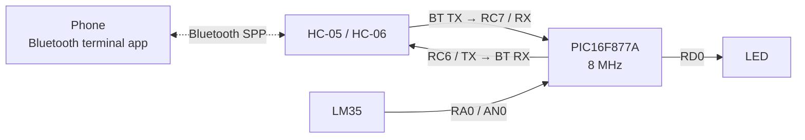
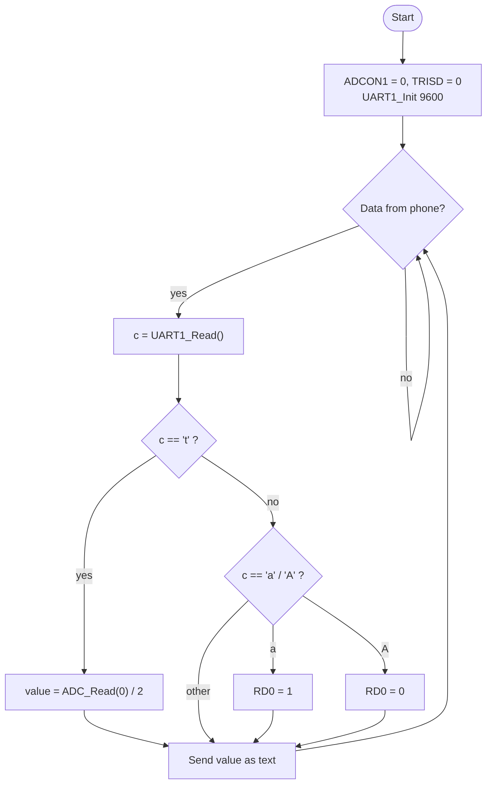

# Microcontroller-Bluetooth

Wireless control of a PIC16F877A from a **phone** over Bluetooth, using an HC-05/HC-06-style serial Bluetooth module. The module acts as a wireless UART, so the firmware uses the same single-character commands as the Serial project.

## Target hardware & settings

| Setting | Value |
|---|---|
| Microcontroller | **PIC16F877A** |
| Clock | 8 MHz crystal (HS) |
| UART | **9600 baud, 8N1** (actual 9615 bps, 0.16 % error), which is the default rate of HC-05/HC-06 modules |
| Compiler / IDE | mikroC PRO for PIC (`UART`, `ADC`, `Conversions`) |
| Config word | `0x2F4A`: HS oscillator, WDT off, PWRT off, BOR on, LVP off, no code protection |

## Wiring

| Signal | Pin |
|---|---|
| PIC TX → module RXD | RC6 |
| Module TXD → PIC RX | RC7 |
| LED | RD0 |
| LM35 temperature sensor | RA0 / AN0 (Bluetooth 2 only) |

> Most HC-05 modules have a 3.3 V RXD pin. Use a simple voltage divider (e.g. 1k/2k) on the PIC TX → module RXD line.

## Sub-projects

### `BlueTooth 1/`: LED remote
- Each received character is echoed back to the phone.
- `a` turns the LED on RD0 **on**, and `A` turns it **off**.

### `BlueTooth 2 temp/`: LED + temperature
- `t`: reads AN0, divides by 2 (≈ °C for an LM35 at a 5 V reference), and stores the result.
- `a` / `A`: LED on RD0 on / off.
- After **every** command it sends the last temperature value as text, so the phone always gets a reading back.

## How to test
1. Pair the phone with the module (PIN is usually `1234` or `0000`).
2. Open any Bluetooth serial terminal app and connect.
3. Send `a`, `A` or `t`.

## Build & flash
Open `blue 1.mcppi` in the sub-project folder with mikroC PRO for PIC, build, and flash `blue 1.hex`.
